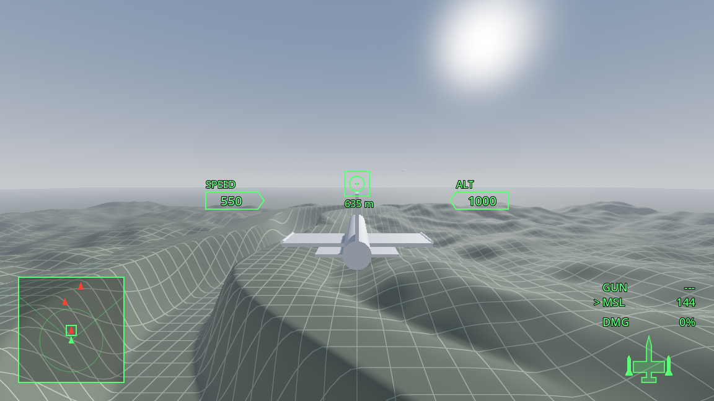
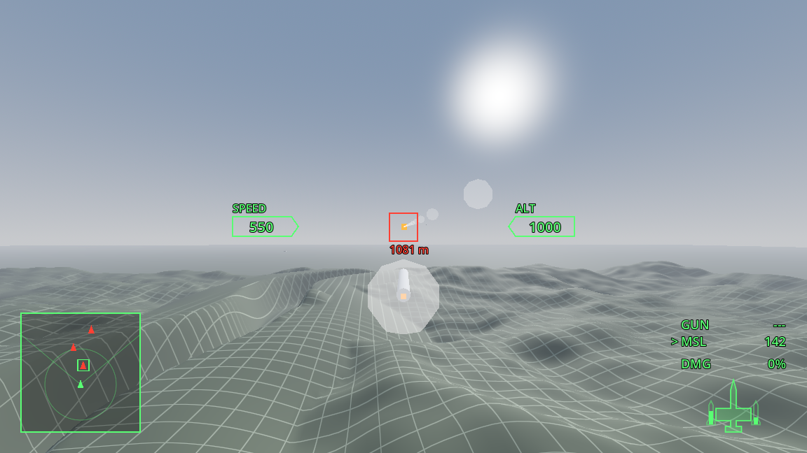
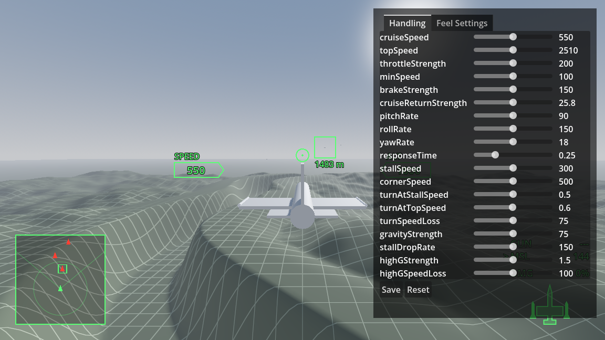
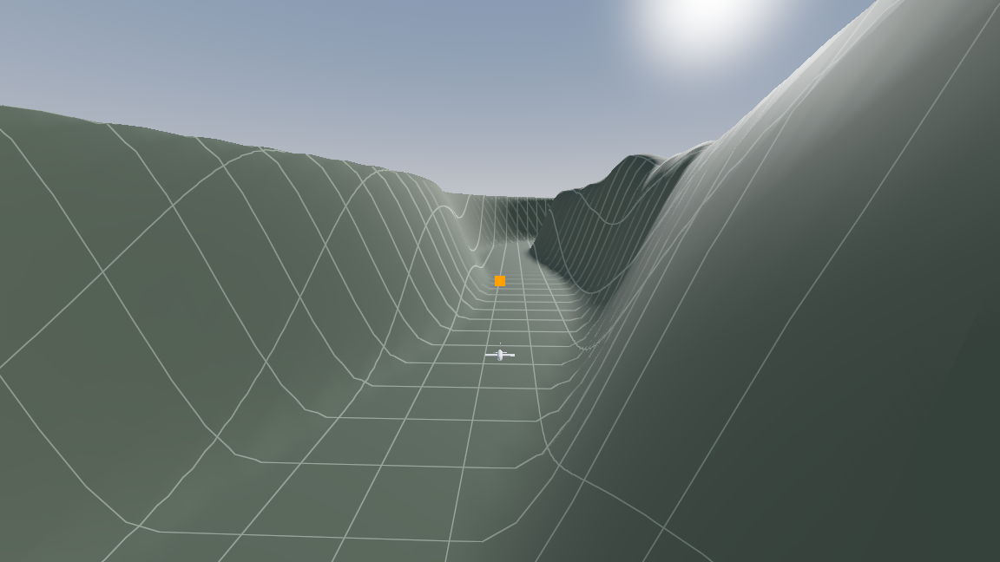

# Flight Combat Sandbox

A single-player arcade flight combat game in the spirit of Ace Combat, with an in-game Mission editor planned: Super Mario Maker for air combat. Built in Godot 4 (.NET) and C#.

It is a work in progress and a learning project. Step 1 of 6 (flying) is done and step 2 (fighting) is under way.

| | |
|---|---|
|  |  |
| The HUD: speed, altitude, a Target 635 m ahead with the gun reticle on it, the radar and the weapons. | The missile camera, following a missile to a locked Target. |
|  |  |
| The tuning panel, open on the first jet's Handling. | An AI Pilot flying the test canyon to its point, the orange marker. |

## How this was built

I'm building this with [Claude Code](https://claude.com/claude-code) to learn how to work with an AI coding agent, and I'm new to game engines. Claude writes the code and the docs. I set the design, choose between the options it offers, play every change and say when it feels right. Every commit is co-authored by Claude.

The files that show how we work:

- [CLAUDE.md](CLAUDE.md): the standing instructions Claude reads at the start of each session.
- [GLOSSARY.md](GLOSSARY.md): the project's vocabulary, so code, UI text and docs use the same words.
- [docs/SPEC.md](docs/SPEC.md): the confirmed design.
- [docs/adr/](docs/adr/): one short file per hard-to-reverse decision.
- [tasks/plan.md](tasks/plan.md): the roadmap and the risks.
- [tasks/todo.md](tasks/todo.md): every task, with what "done" means, how it was checked, and what I found when I played it.

## What works today

- An arcade flight model with stall, high-G turns and speed lost in hard turns, driven by Handling values in a data file.
- A live tuning panel (F1) that changes any Handling value or Feel Setting mid-flight and saves it back.
- Chase and nose views, look-around, a Target camera and a missile camera.
- A gun with a reticle that marks where the rounds will be at the Target's distance, lock-on, and missiles on Hardpoints that reload.
- A HUD, a radar minimap and a large radar map.
- An AI Pilot that flies the same flight model through the same controls and avoids terrain. Between passes on its point it makes attack runs on the Player and breaks off after each one, at one of four Skills. It doesn't shoot yet.

Everything is gray boxes over generated test terrain. Models, sounds, Missions and the editor come in later steps.

## Run it

Built and played on Windows. You need:

- [Godot 4.7.2, .NET edition](https://godotengine.org/download/archive/)
- the .NET SDK, version 8 or newer

Open the `game` folder in Godot and press F5. Core's tests run without Godot:

```bash
dotnet test core.tests
```

## Controls

The layout follows Ace Combat 7's PlayStation defaults on a DualSense, with a keyboard fallback.

| Action | DualSense | Keyboard |
|---|---|---|
| Pitch and roll | Left stick | W (dive), S (climb), A, D |
| Yaw | L1, R1 | Q, E |
| Throttle, brake | R2, L2 | Shift, Ctrl |
| High-G turn | R2 + L2 while turning | Shift + Ctrl while turning |
| Gun | Cross | Space |
| Missile (hold to follow it) | Circle | F |
| Switch Target (tap), look at it (hold) | Triangle | T |
| Look around | Right stick | Arrow keys |
| Change view | R3 | V |
| Large radar map | Touchpad | M |
| Pause | Options | Esc |

## Layout

- `game/`: the Godot project: flight, combat, AI, HUD and input.
- `core/` and `core.tests/`: plain C# with no Godot in it, and its xUnit tests.
- `packs/base/`: the base Pack: the data files for the first jet, its missile and the Feel Settings.
- `docs/` and `tasks/`: the design, the decisions and the task list.

## Rights

Everything in this repository is original: no names, designs, models or music from Ace Combat or any other game. The project is not affiliated with Bandai Namco. No license is granted yet.
